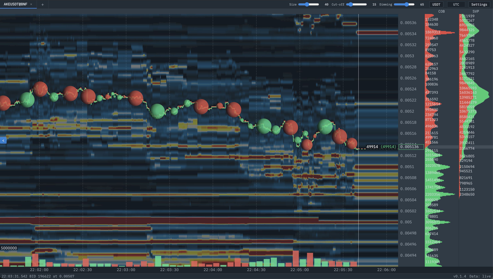

# Deepmarket

Live orderflow charts for crypto perpetual futures. See resting liquidity,
executed trades and session volume in a desktop browser.



*Deepmarket — live orderflow for AKEUSDT on Binance Futures.*

## Features

- Binance USDT-M and Bybit linear perpetuals, with up to five instrument tabs.
- Liquidity heatmap, buy/sell trade bubbles and bid/ask lines.
- Current order book (COB) and session volume profile (SVP).
- Rolling four-hour heatmap history, preserved across clean server restarts.
- Time and price zoom, display controls, coin/USDT units and fixed UTC offsets.

Each tab follows one instrument on one exchange. Deepmarket displays market data;
it does not place trades. Historical heatmap data starts when you open a tab.

## Run with Docker

Requirements: Docker Engine with Compose v2 (or Docker Desktop), a Linux/amd64
container environment and a modern desktop browser with WebGL. Native ARM images
are not provided in this release. The browser renders the charts; the server
does not need a GPU.

Download `deepmarket-v1.0.0-linux-amd64.tar.gz`, `compose.yaml` and `SHA256SUMS`
from [release v1.0.0](https://github.com/snailBoob/deepmarket/releases/tag/v1.0.0).
Put them in a dedicated directory, then run:

```sh
sha256sum --check --ignore-missing SHA256SUMS
docker load -i deepmarket-v1.0.0-linux-amd64.tar.gz
docker compose up -d --wait
```

The checksum command above is for Linux. On macOS use `shasum -a 256` on the
downloaded image and compare it with its entry in `SHA256SUMS`.

### Build from source

Alternatively, download the release's source archive, extract it and run from
that directory:

```sh
docker build -t deepmarket:local .
DEEP_MARKET_IMAGE=deepmarket:local docker compose up -d --wait
```

Open **http://localhost:8740**. Click **+**, choose an exchange and symbol, and
subscribe. No exchange account or API key is required for the public market feeds.
Exchange availability depends on your network and region.

Use the `DEEP_MARKET_IMAGE=deepmarket:local` override whenever starting your
source-built image.

### Network access

There is no login. Run Deepmarket on a trusted local network; do not expose it
directly to the internet. Tabs and display settings are shared by all browsers
connected to the same instance.

Compose binds port 8740 on all host interfaces by default. To restrict access
to the same computer:

```sh
DEEP_MARKET_BIND=127.0.0.1 docker compose up -d --wait
```

Set `DEEP_MARKET_PORT` to choose another host port. A reverse proxy must forward
WebSocket upgrades for `/ws`.

## Using the chart

- **Mouse wheel:** zoom the time axis.
- **Drag the price axis:** change the price zoom.
- **Back / Live:** browse recent history or return to live time.
- **Active tab name:** edit the subscription settings.
- **Settings:** adjust heatmap and trade-bubble display.
- **Coins / USDT:** switch displayed size units.

The heatmap extends the current book to the right of the live-time line. Trades
and volume stop at that line. Hover over the chart for details in the status bar.
Closing a tab stops tracking that instrument and deletes its stored history.

## Data, resources and updates

The `market-data` Docker volume stores subscriptions, display settings and rolling
history. Keep the same Compose directory/project name to keep using that volume.
`docker compose down` preserves it; `docker compose down --volumes` deletes it.

Compose allows up to 2 GB RAM. A memory guard saves state and restarts the process
when its measured memory exceeds 1500 MB. Actual load depends on the instruments
and activity. Large, active markets may need more resources than quiet altcoins.

Before upgrading, stop the service cleanly and back up its volume. Download and
load the new release image and use its Compose file in the same directory, then
repeat the startup command. Keep the previous image and its matching Compose file
for rollback. Source installations can rebuild their local image. Updates interrupt
the feed briefly; downtime appears as a gap in history.

## Troubleshooting

```sh
docker compose logs --tail=100 deepmarket
```

Logs use UTC timestamps and identify the exchange and instrument. `book_live`
indicates a synchronized book; `book_stale` indicates no applied book update for
30 seconds. Check connectivity and exchange availability if it persists.

If the page loads but live data does not, check the browser connection indicator
and reverse-proxy WebSocket settings. Container health measures HTTP responsiveness,
not whether an exchange feed is current.

## License and feedback

Deepmarket uses [PolyForm Noncommercial 1.0.0](LICENSE), with an additional
permission for personal trading for your own account, including profits and
ordinary margin/leverage. The license permits noncommercial use, modification
and distribution, and expressly permits use by the noncommercial organizations
it lists. Commercial uses outside the granted permissions require a separate
license. This is source-available software, not open source.

Commercial licensing: **licensing@cryptotraderjourney.com**.
Third-party components retain their [own licenses](THIRD_PARTY_NOTICES.md).

Bug reports and ideas are welcome. Please read [CONTRIBUTING.md](CONTRIBUTING.md);
code contributions are not currently accepted.
